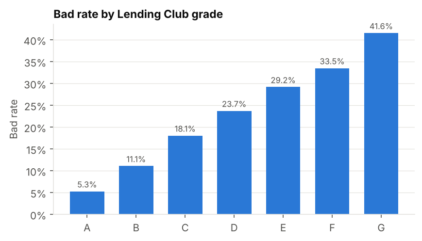
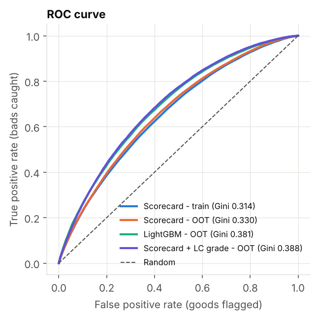
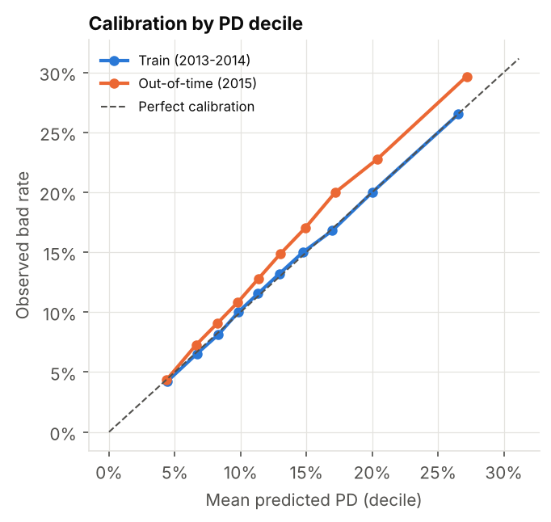
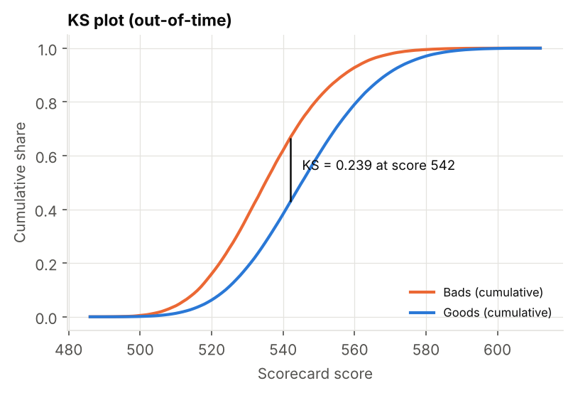
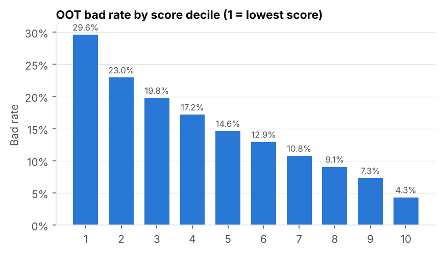
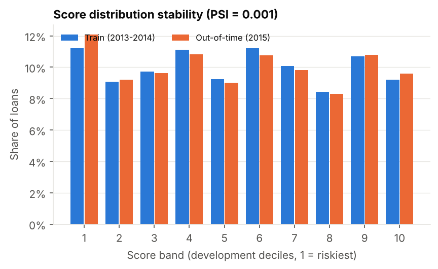
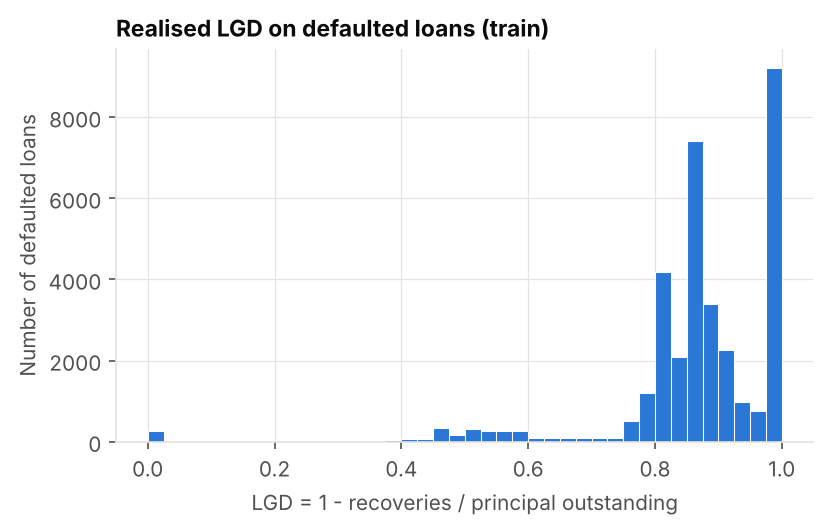
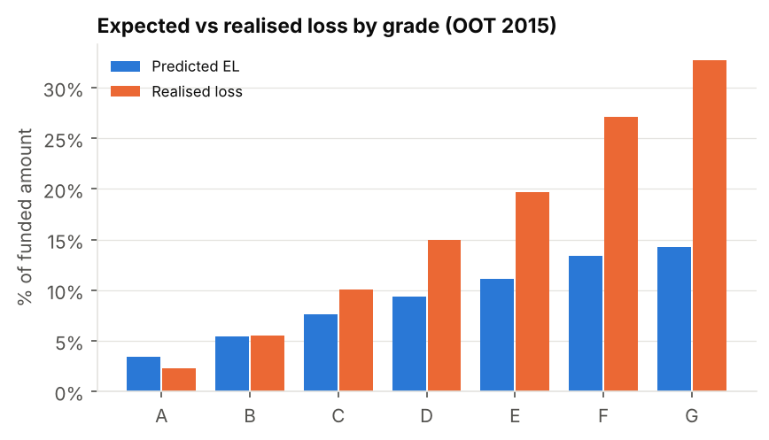
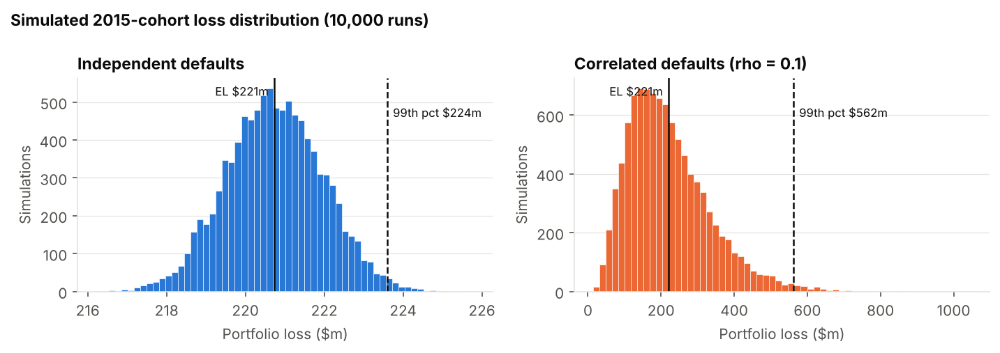
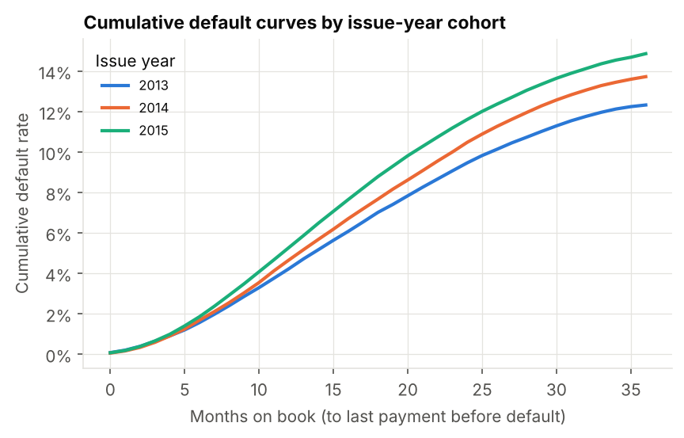

# Credit Risk Expected Loss Modelling (PD, LGD, EAD)

An end-to-end retail credit-risk project on public Lending Club data. It builds a **PD scorecard** (WoE/IV binning + logistic regression, scaled to points), a **two-stage LGD** model and an **EAD** model. These are combined into **Expected Loss = PD × LGD × EAD**, and everything is validated **out-of-time**.

Built in Python with pandas, Scikit-learn and Statsmodels. Every number below comes from `python run_all.py` and is stored in [`reports/results.json`](reports/results.json).

**[Open the interactive dashboard →](https://harshath1234.github.io/credit-risk-expected-loss/)** Five tabs (overview, PD scorecard, validation, LGD/EAD, expected loss), generated from the same results by `build_site.py`.

## 1. Summary

The scorecard uses borrower and credit-bureau information only. It deliberately excludes Lending Club's own grade and interest rate. It ranks risk consistently on an unseen later year of loans (2015), and the score distribution is very stable. Calibration drifts because the 2015 bad rate rose. Expected loss captures **83%** of realised 2015 losses, and the gap is traced mainly to that PD under-calibration.

| Headline metric (out-of-time = 2015 issues) | Value |
|---|---|
| Loans used (36-month, resolved, 2013–2015) | 545,607 (bad rate 14.1%) |
| PD scorecard Gini / AUC (OOT) | **0.330** / 0.665 (train 0.314 / 0.657) |
| KS (OOT) | **0.239** (train 0.224) |
| Brier score (OOT) | 0.121 |
| Score PSI, train → OOT | **0.001** (stable) |
| Scorecard features | 11 (from 32 candidates) |
| LGD: mean actual vs predicted (OOT defaults) | 87.2% vs 86.7%; RMSE 0.151 |
| EAD RMSE (OOT defaults) | $3,352 per loan (R² 0.68) |
| Portfolio EL (OOT) | $220.7m = **6.1%** of $3.62bn funded |
| Realised loss (OOT) | $267.3m = 7.4% → **EL / realised = 0.83** |

> **Currency.** Lending Club is a US lender, so all amounts are in **US dollars**.

## 2. Data and scope

- **Source:** Kaggle *Lending Club Loan Data* (`loan.csv`, 2,260,668 loans × 145 columns, issued 2007–2018 Q4). See [`data/README.md`](data/README.md) for how to download it. Raw data is not committed.
- **Note:** this version of the dataset has **no FICO score columns**. Instead, the "bureau" signal comes from 13 credit-bureau attributes captured at application, such as bankcard utilisation, accounts opened in the last 24 months, months since the most recent enquiry, and total credit limit.
- **Filters:**
  - **36-month** loans only, so every loan has the same default horizon.
  - **Individual** applications only. Joint applications start in late 2015 and their income and DTI are household-level.
  - **Resolved** outcomes only. *Current*, *Late* and *In Grace* loans are dropped because their outcome is unknown, and counting them as good would understate risk.
- **Default definition:**
  - **Bad = 1:** `Charged Off`, `Default`, `Does not meet the credit policy. Status:Charged Off`
  - **Good = 0:** `Fully Paid`, `Does not meet the credit policy. Status:Fully Paid`
- **Out-of-time split:** train on **2013–2014** issues (262,992 loans) and test on **2015** issues (282,615 loans). The years were chosen from the outcome counts in [`reports/status_by_year_36m.csv`](reports/status_by_year_36m.csv):
  - 2015 loans are 99.9% resolved by the December 2018 cut-off.
  - 2016 loans are only 66.6% resolved, and their resolved bad rate is inflated to 20.9% because early defaults resolve first.
  - About half of 2012 loans are missing the bureau attributes, which Lending Club started capturing mid-2012.

| Issue year | Loans | Bad rate |
|---|---|---|
| 2013 | 100,422 | 12.3% |
| 2014 | 162,570 | 13.7% |
| 2015 | 282,615 | 14.9% |

| Grade | A | B | C | D | E | F | G |
|---|---|---|---|---|---|---|---|
| Bad rate | 5.3% | 11.1% | 18.1% | 23.7% | 29.2% | 33.5% | 41.6% |



## 3. PD scorecard

**Why WoE + logistic regression?**
- Weight of Evidence puts every feature on the log-odds scale that logistic regression uses.
- It handles missing values and outliers as their own bins.
- Monotonic bins make the model explainable. For example, "more recent credit enquiries → fewer points".
- This is still the standard for regulated retail scorecards, because each attribute's contribution is transparent.

**Steps** (implemented by hand in [`src/woe_binning.py`](src/woe_binning.py) and [`src/pd_model.py`](src/pd_model.py)):

1. **Fine classing:** split each numeric feature into 20 quantile bins. Categories keep their own levels.
2. **WoE and IV:**
   - WoE = ln(%good / %bad), with a 0.5 smoothing count so empty cells don't break the log.
   - IV = Σ (%good − %bad) × WoE.
3. **Coarse classing:** merge adjacent bins until the bad rate is **monotonic** and every bin holds **≥ 5%** of loans. Categories are merged by bad-rate order. A manual binning of revolving utilisation at round business cut-points (20/40/60/80%) is saved alongside the automatic one for comparison (`reports/manual_binning_revol_util.csv`).
4. **Feature selection:**
   - Drop IV < 0.02 (14 features).
   - Flag IV > 0.5 as possible leakage (none found).
   - Drop the lower-IV feature of any pair with |correlation| > 0.7 (6 features).
   - Check VIF (all ≤ 5).
   - Remove any feature with a wrong (positive) sign or p > 0.05 (`mort_acc`, p = 0.19).
5. **Model:** fit a Statsmodels `Logit` for the coefficient table, then refit the same unpenalised model in Scikit-learn for scoring. The coefficients agree to within 1e-6.

**Top features by IV** (full table in [`reports/iv_table.csv`](reports/iv_table.csv)):

| Feature | IV | Kept? |
|---|---|---|
| annual_inc | 0.091 | ✓ |
| tot_hi_cred_lim (total credit limit) | 0.079 | ✓ |
| bc_open_to_buy (unused bankcard credit) | 0.079 | ✓ |
| avg_cur_bal | 0.074 | ✗ corr 0.87 with tot_hi_cred_lim |
| total_rev_hi_lim | 0.058 | ✗ corr 0.70 with bc_open_to_buy |
| acc_open_past_24mths | 0.056 | ✓ |
| dti | 0.052 | ✓ |

All IVs fall in the "weak" band (0.02–0.1). Without FICO, no single variable is strong, and the model's power comes from combining many of them.

**Final model:** 11 features. All coefficients are negative, as expected with WoE = ln(good/bad), and all have p < 1e-20. Full table in [`reports/coefficients_statsmodels.csv`](reports/coefficients_statsmodels.csv).

| Feature | Coef | Feature | Coef |
|---|---|---|---|
| acc_open_past_24mths | −0.90 | percent_bc_gt_75 | −0.57 |
| loan_to_income | −0.86 | tot_hi_cred_lim | −0.54 |
| mths_since_recent_inq | −0.81 | dti | −0.50 |
| bc_open_to_buy | −0.64 | mo_sin_rcnt_tl | −0.47 |
| mo_sin_old_rev_tl_op | −0.38 | home_ownership | −0.38 |
| annual_inc | −0.29 | intercept | −1.89 |

**Scaling:**
- Score = Offset + Factor × ln(good:bad odds), with **PDO = 20** and **600 points at 50:1**.
- So Factor = 20 / ln 2 = 28.85 and Offset = 600 − 28.85 × ln 50 = 487.12.
- The intercept is spread evenly across the 11 features.
- Each attribute's points = −Factor × (β × WoE + β₀ / 11) + Offset / 11. See [`reports/scorecard_points.csv`](reports/scorecard_points.csv).

**Worked example** (first 2015 applicant; [`reports/worked_example.csv`](reports/worked_example.csv)):

| Feature | Value | Bin | Points |
|---|---|---|---|
| annual_inc | 65,000 | (60,000, 65,000] | 50 |
| tot_hi_cred_lim | 314,017 | (306,555, 465,858] | 57 |
| bc_open_to_buy | 57,830 | > 22,013 | 62 |
| acc_open_past_24mths | 4 | (3, 4] | 49 |
| dti | 16.06 | (15.71, 19.06] | 50 |
| loan_to_income | 0.38 | > 0.3462 | 40 |
| home_ownership | MORTGAGE | OTHER / MORTGAGE | 52 |
| mo_sin_rcnt_tl | 2 | (1, 2] | 46 |
| mo_sin_old_rev_tl_op | 192 | (154, 196] | 50 |
| percent_bc_gt_75 | 7.7 | ≤ 14.3 | 54 |
| mths_since_recent_inq | 0 | ≤ 1 | 43 |
| **Total** | | | **553** |

The score converts back to a PD like this: odds = exp((553 − 487.12) / 28.85) = 9.8:1, so **PD = 1 / (1 + 9.8) = 9.3%**. The applicant loses points for a large loan relative to income and a credit enquiry this month. They gain points for lots of unused bankcard credit.

**Comparison with Lending Club's own pricing:** adding `sub_grade` (WoE-binned) raises OOT Gini from 0.330 to **0.388**. LC's grade contains information we don't have, most obviously FICO and LC's internal model. The main scorecard leaves it out on purpose: a model built on LC's grade would mostly be copying LC's own model.

## 4. Validation (out-of-time = 2015)

| Metric | Train 2013–14 | OOT 2015 | How to read it |
|---|---|---|---|
| AUC | 0.657 | 0.665 | Probability that a random bad scores riskier than a random good |
| **Gini** | 0.314 | **0.330** | 2·AUC − 1; 0 = random, 1 = perfect |
| **KS** | 0.224 | **0.239** | Largest gap between the cumulative bad and good score distributions |
| Brier | 0.110 | 0.121 | Mean squared error of PD (lower is better) |
| Mean PD vs bad rate | 13.2% vs 13.2% | 13.3% vs **14.9%** | Calibration in the large |
| Hosmer–Lemeshow (10 groups) | χ² 10.5, p = 0.23 | χ² 663, p ≈ 0 | p > 0.05 means no evidence of miscalibration |
| Rank ordering | monotonic | monotonic | Bad rate falls in every score decile |

 

**Discrimination holds out of time.** OOT Gini (0.330) is slightly *above* train (0.314). Differences this small are normal variation between populations. It isn't a sign of leakage: the leakage guard in `run_all.py` and `tests/` blocks every post-origination field from the PD model. Gini around 0.33 is modest by bank standards, where application scorecards with bureau scores typically reach 0.5–0.7. The missing FICO score and Lending Club's pre-screening (we only see approved loans) are the main reasons.

**Rank ordering (OOT gains table):**
- The bad rate falls from **29.6%** in the lowest-score decile to **4.3%** in the highest.
- The worst 30% of scores capture **48.7%** of bads.
- See [`reports/gains_oot.csv`](reports/gains_oot.csv).

 

**Calibration drifts.**
- On train, predicted and observed bad rates match in every decile.
- In 2015 the observed bad rate is above prediction in 9 of 10 deciles (binomial p < 0.05), by about 10–16%.
- This matches the rising year-by-year bad rate (12.3% → 13.7% → 14.9%), a change in the economy and in LC's lending rather than in who was applying (see PSI below).
- A logit intercept shift of +0.13 would realign the average. In practice you'd recalibrate on the most recent resolved data rather than on the test year itself.

**Stability:**
- **PSI on the score = 0.001.** That's far below the 0.10 "stable" threshold.
- **CSI per feature:** all ≤ 0.028. The largest are `mo_sin_old_rev_tl_op` and `percent_bc_gt_75`.
- So the 2015 applicants look like the 2013–14 applicants. Only their outcomes got worse.
- This is the textbook case where **PSI alone would miss a problem**, and why calibration has to be monitored alongside it.



**Benchmark:**
- A LightGBM model on the same raw origination features reaches OOT Gini **0.381** (train 0.514, so it overfits noticeably).
- The scorecard gives up about 0.05 Gini in return for full transparency: a points table, monotonic attributes and stable coefficients.

## 5. LGD

- **Definition:**
  - Recovery rate = `recoveries` / (`funded_amnt` − `total_rec_prncp`), i.e. recoveries over principal outstanding at default, clipped to [0, 1].
  - **LGD = 1 − RR.**
  - Gross recoveries are used (collection fees ignored), and they are not discounted.
- **Population:** defaulted loans with positive exposure (34,693 train, 42,005 OOT).
- **Distribution:** heavily skewed towards loss, with two modes rather than one.
  - **18.6%** of defaults recover nothing (LGD = 100%).
  - Most of the rest cluster around **LGD ≈ 85–90%**, consistent with Lending Club selling charged-off debt to collection agencies for a small fraction of face value.
  - Mean LGD is 86.7%.
  - One linear regression would aim between the two modes. That's the reason for the two-stage design.



- **Two-stage model** ([`src/lgd_model.py`](src/lgd_model.py)), both stages in Statsmodels:
  - Stage 1: logistic regression for P(any recovery > 0).
  - Stage 2: fractional logit (Binomial GLM) for E[RR | RR > 0].
  - **E[LGD] = 1 − P(recovery) × E[RR | recovery].**

| OOT defaults (2015) | Mean actual | Mean predicted | RMSE | MAE |
|---|---|---|---|---|
| Two-stage model | 87.2% | 86.7% | **0.1515** | 0.0999 |
| Grade × purpose average | 87.2% | 86.7% | 0.1517 | 0.0995 |
| Single overall mean | 87.2% | 86.7% | 0.1516 | 0.0994 |

**Honest result: the model barely beats a flat average.**
- Stage 1 separates recovery from no-recovery only weakly (OOT AUC 0.57).
- Stage 2 has almost no significant predictors.
- Actual LGD is flat across grades (87.0–87.4%).
- At Lending Club, recovery is driven by the collection process and debt-sale pricing, not by borrower characteristics at origination.
- For EL, the model therefore works as a well-calibrated segment average (by grade: [`reports/lgd_by_grade_oot.csv`](reports/lgd_by_grade_oot.csv)).
- In a bank setting, collateral, time in collections and macro conditions would carry the LGD signal.

## 6. EAD

For an **amortising term loan** there's no undrawn limit. Exposure only falls as the borrower repays, so EAD = principal outstanding at default. The model target is the share of the original amount still owed:

`EAD ratio = (funded_amnt − total_rec_prncp) / funded_amnt`, clipped to [0, 1], and `EAD = ratio × funded_amnt`.

This is modelled with a fractional logit (Statsmodels Binomial GLM) on origination features ([`src/ead_model.py`](src/ead_model.py)).

> For **revolving** products (cards, overdrafts), a credit conversion factor (CCF) is applied to the *undrawn* limit instead: EAD = drawn + CCF × (limit − drawn). That doesn't apply here.

| OOT defaults (2015) | Mean actual | Mean predicted | RMSE | R² |
|---|---|---|---|---|
| EAD ratio, model | 58.4% | 57.2% | 0.231 | 0.040 |
| EAD ratio, grade average | 58.4% | 57.1% | 0.232 | 0.037 |
| **EAD ($), model** | $7,298 | $7,118 | **$3,352** | 0.676 |
| EAD ($), grade average | $7,298 | $7,105 | $3,363 | 0.674 |

- On average, 58% of the loan is still owed at default. Riskier grades default earlier, so more is outstanding: from 50.5% (A) to 76.5% (G).
- Most of the dollar-EAD R² comes from loan size. *When* a borrower defaults is hard to predict at origination.

## 7. Expected Loss

**EL_i = PD_i × LGD_i × EAD_i** for every loan, defaulted or not, using model-predicted LGD and EAD. With 36-month loans and a whole-life default flag, this is a **lifetime** expected loss per loan (see section 8).

| | Train 2013–14 | **OOT 2015** |
|---|---|---|
| Loans | 262,992 | 282,615 |
| Funded amount | $3.32bn | $3.62bn |
| **Expected loss** | $201.9m (6.09%) | **$220.7m (6.10%)** |
| Realised loss | $208.6m (6.29%) | $267.3m (7.39%) |
| **EL / realised** | 0.97 | **0.83** |
| Riskiest 10% by PD: share of EL | 20.1% | 20.5% |

**Back-test decomposition (OOT).** Each component is compared with what actually happened:
- PD: predicted / actual = 0.895
- EAD: 0.975
- LGD: 0.988

Together these explain most of the 17% shortfall. The rest (about 3%, also visible in-sample) comes from defaulted loans having larger exposures than the average loan.

**By grade:**
- EL is too high for grade A (3.4% predicted vs 2.3% realised).
- EL is too low for D–G (for example E: 11.1% vs 19.7%).
- This is expected: the scorecard excludes Lending Club's grade, so it can't fully separate LC's highest-risk tiers.
- See [`reports/el_by_grade_oot.csv`](reports/el_by_grade_oot.csv).



**Stress test (OOT portfolio):**

| Scenario | EL | % of funded | vs base |
|---|---|---|---|
| Base | $220.7m | 6.10% | — |
| PD × 1.5 | $331.1m | 9.15% | +50% |
| LGD + 10 pts | $246.3m | 6.81% | +12% |
| Combined | $369.4m | 10.21% | +67% |

The LGD shock matters less than the PD shock because LGD is already about 87%. Adding 10 points is only about a 12% relative increase, and it's capped at 100%.

**Monte Carlo loss distribution** (10,000 simulations of the 2015 cohort, Bernoulli defaults at each loan's predicted PD):
- **Independent defaults:** the 99th-percentile loss is $223.6m, only **$2.9m** above EL. Diversification across 282k loans removes almost all of the randomness.
- **Correlated defaults:** a one-factor Gaussian copula (the Vasicek model behind Basel IRB) with an *assumed* asset correlation ρ = 0.10. The 99th percentile is **$561.7m**, i.e. **$340.8m of unexpected loss** above EL. This is what bank capital exists to cover.
- ρ = 0.10 is an illustrative assumption, not an estimate. Basel's retail correlations range from 0.03 to 0.16.



**Cohort default curves:**
- Each newer cohort defaults faster: by month 24, 9.5% of 2013 loans, 10.5% of 2014 loans and 11.6% of 2015 loans had defaulted.
- That's the same deterioration that breaks the 2015 calibration, and it's visible in the curves long before loans mature.
- Timing proxy: months from issue to last payment before charge-off.



## 8. IFRS 9 / Basel IRB context and limitations

**Common building block.** Both regimes decompose credit loss as EL = PD × LGD × EAD. They differ in horizon, in the economic conditions assumed, and in what the number is used for.

**Basel IRB (regulatory capital):**
- **PD** is a **12-month** probability, leaning **through-the-cycle**: a long-run average default rate, with a regulatory floor (0.05% for retail under Basel 3.1/CRR3).
- **LGD** must reflect **downturn** conditions, and **EAD** must be conservative.
- **Provisions cover expected loss; capital covers unexpected loss.** Capital is set from the Vasicek formula at a 99.9% confidence level, the same idea as the correlated Monte Carlo above.

**IFRS 9 (accounting provisions, expected credit loss):**
- Estimates are **point-in-time** and **forward-looking**. They are weighted across several macroeconomic scenarios and discounted at the effective interest rate.
- **Staging:**
  - **Stage 1:** 12-month ECL for performing loans.
  - **Stage 2:** **lifetime** ECL after a significant increase in credit risk.
  - **Stage 3:** lifetime ECL for credit-impaired loans.

**How this project differs (limitations):**
1. **Horizon:** the PD is a **lifetime** (36-month) default probability, not a 12-month PD. The EL is closest to an undiscounted, single-scenario lifetime ECL. It isn't a Basel 12-month EL or an IFRS 9 Stage 1 number.
2. **No macro overlay or scenarios.** The 2015 calibration drift is exactly what a forward-looking adjustment is meant to catch.
3. **No discounting** of recoveries or cash flows. Recoveries are reported cumulatively with no timing, and gross of collection fees.
4. **No downturn LGD.** The 2013–15 vintages defaulted in a benign US economy.
5. **Reject-inference bias.** Only approved loans are observed. Lending Club had already screened out its riskiest applicants, which flattens the score range and limits Gini.
6. **No FICO** in this version of the data. One lender, one product (unsecured personal loans), US only.
7. The default definition follows Lending Club's statuses ("Default" = 121+ days past due, after which loans are charged off). It is later than the Basel 90-days-past-due definition.
8. This is a portfolio project. It is **not** a bank-grade or regulator-approved model.

## 9. How to reproduce

```bash
git clone https://github.com/harshath1234/credit-risk-expected-loss.git
cd credit-risk-expected-loss
pip install -r requirements.txt          # Python 3.13; pinned versions
# put loan.csv in data/ (see data/README.md)
python run_all.py                        # ~8 minutes; writes reports/ and reports/figures/
python build_site.py                     # rebuilds the dashboard, docs/index.html, from reports/
python notebooks/build_notebooks.py      # optional: re-execute the walkthrough notebooks
pytest -q                                # unit checks (WoE sign, monotonic bins, leakage, PSI, scaling)
```

- Seed **42** throughout. All settings live in [`config.yaml`](config.yaml).
- `run_all.py --until N` stops after phase N (1 data · 2 scorecard · 3 validation · 4 LGD/EAD · 5 EL).

```
├── run_all.py            one command → every table, figure and results.json
├── build_site.py         reports/ → docs/index.html (the interactive dashboard on GitHub Pages)
├── site/template.html    dashboard page template (layout, charts); data is injected at build time
├── docs/                 the published dashboard (GitHub Pages serves this folder)
├── config.yaml           split years, binning thresholds, PDO/base score, stress settings
├── src/                  data_prep · woe_binning · pd_model · validation · lgd_model · ead_model · expected_loss · plots
├── notebooks/            01_eda · 02_pd_scorecard · 03_lgd_ead · 04_expected_loss (read-only walkthroughs)
├── reports/              results.json, CSV tables, figures/
└── tests/                light unit checks
```

## 10. Next steps

- **Recalibrate:** refit the intercept, or apply Platt scaling on the most recent resolved vintage. Then monitor PSI **and** observed-vs-expected every quarter, with a redevelopment trigger, e.g. PSI > 0.25 or a persistent calibration breach.
- **12-month and lifetime PD curves:** use a discrete-time hazard or survival model on months-on-book. That allows IFRS 9 Stage 1 vs Stage 2 ECL and a SICR (significant increase in credit risk) rule.
- **Macro scenarios:** link the PD intercept to unemployment, for example, and weight base, upside and downside scenarios.
- **Downturn LGD** and discounted recoveries using recovery timing.
- Add FICO, using the Kaggle version that includes it, and reject inference, to test how much of the Gini gap they close.
